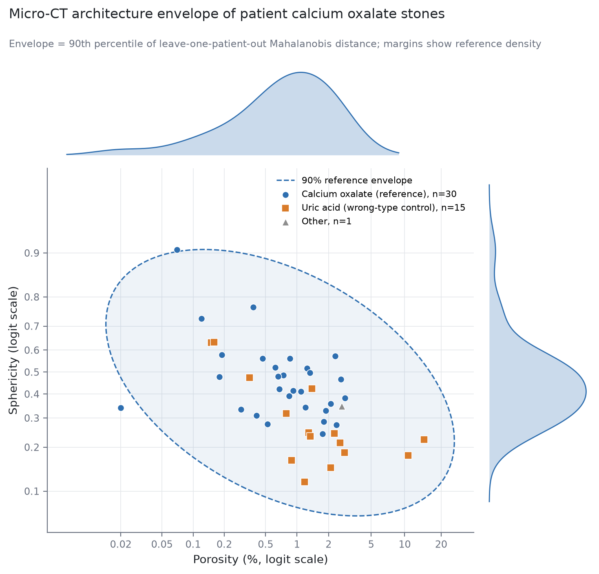
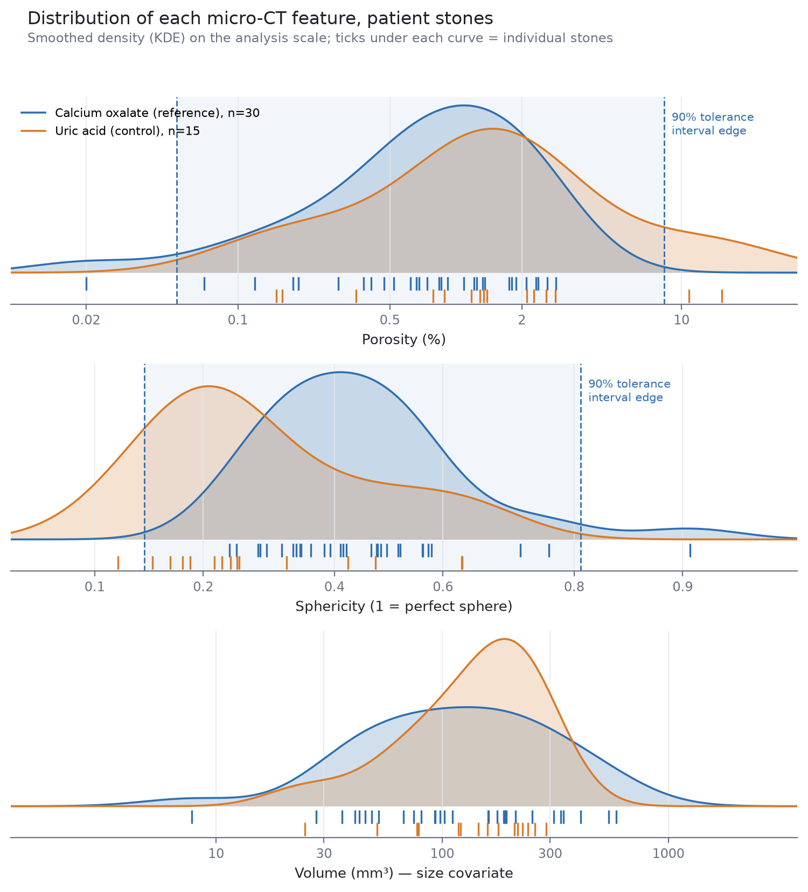

# stone-benchmark

A reference range for real patient kidney stones, built from micro-CT. Its job is to tell us whether lab-grown "stone farm" stones are similar to real ones.

It uses two features per stone:

- **Porosity**: percent of the stone volume that is empty space (closed pores).
- **Sphericity**: how close the shape is to a sphere. 1.0 means a perfect sphere. It's computed from volume and the Lindblad surface area.

Calcium oxalate stones are the reference. Uric acid stones are the wrong-type control: a good reference range should keep most of them out.

> No patient data is in this repo. `.gitignore` blocks every CSV and spreadsheet. The input file stays on lab machines.

## Run it

Python 3.10+.

```bash
pip install -r requirements.txt
python stone_benchmark.py "MASTER STUDY DATA - ALL.csv"                          # build the reference
python stone_benchmark.py "MASTER STUDY DATA - ALL.csv" farm_stones.csv          # also score farm stones
python feature_distributions.py "MASTER STUDY DATA - ALL.csv"                    # per-feature density plot
```

The input is the lab master spreadsheet exported as CSV. The header is on row 2, and the first column is the patient number with fragment letters (`21a`, `21b`).

To score farm stones, fill in `farm_stones_template.csv`. Get surface area from the same estimator as the reference (Lindblad).

Everything goes into `benchmark_outputs/`:

| File | What it is |
|---|---|
| `report.txt` | All statistics in plain text |
| `reference_benchmark.xlsx` | Counts, descriptives, tolerance intervals, per-stone scores, excluded stones |
| `envelope_figure.png` | Porosity vs sphericity with the 90% envelope |
| `feature_distributions.png` | Density of each feature, calcium oxalate vs uric acid |
| `farm_scores.csv` | Only when a farm file is given |

## How it works

1. Parse the spreadsheet. Stones with no micro-CT volume, porosity or surface area are excluded, and the reason is logged.
2. Move both features to the logit scale, since they're bounded fractions.
3. Treat stones from the same patient as correlated. Every bootstrap and leave-out step resamples patients, not stones. Tolerance intervals use an effective sample size from the intraclass correlation.
4. Build the envelope: the 90th percentile of leave-one-patient-out Mahalanobis distance among the reference stones.
5. Check it against uric acid stones, and check that neither feature depends on stone size.
6. Run sensitivity checks: Lorensen surface area instead of Lindblad, and pure COM stones only.

## Results so far (Oct 16 spreadsheet, run 2026-10-26)




- Only 46 of 137 stones have micro-CT values. The reference is 30 calcium oxalate stones from 20 patients.
- **All 15 uric acid stones fall inside the envelope, so it's too wide to be a useful test yet.**
- AUC for calcium oxalate vs uric acid: 0.69 for both features together, 0.78 for sphericity alone, 0.65 for porosity alone.
- Neither feature depends on stone size.
- Four stones stretch the envelope: 9, 21a, 21b and 21c. The last three are fragments from one patient.
- Neither feature is normal on the logit scale (Shapiro-Wilk p = 0.012 and 0.006). The empirical envelope cut is 11.15, against 4.61 for a normal distribution.

The obvious fix is more stones. The lab PC has micro-CT results for about 90 stones that aren't in the spreadsheet yet. See [`HANDOFF_PC.md`](HANDOFF_PC.md).
